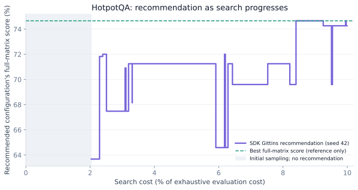
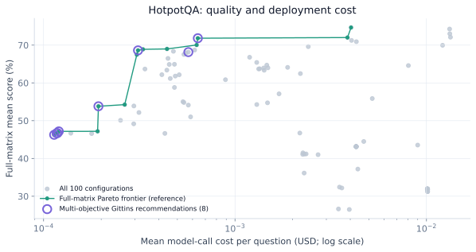
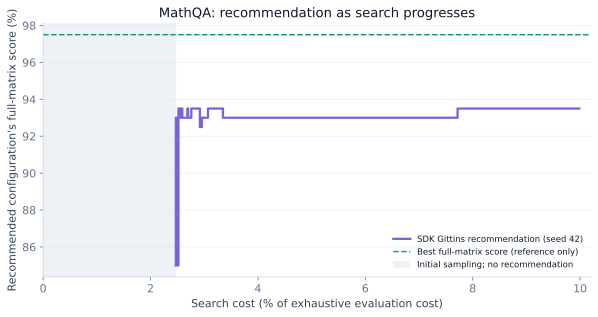
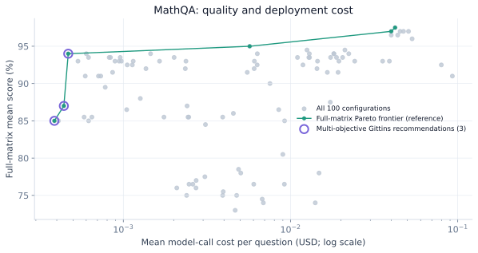

# Benchmark Results

Explore the quality and cost of model combinations, and how Gittins allocates
an evaluation budget. Each experiment below specifies its own model pool and
protocol; compare methods only within a matched experiment.

<div class="ao-benchmark-links" markdown>
[Gittins · 10×10](#gittins-on-a-10x10-model-grid){ .md-button .md-button--primary }
[Earlier benchmark suite](#earlier-benchmark-suite-9-models){ .md-button }
</div>

## Gittins on a 10×10 model grid { #gittins-on-a-10x10-model-grid }

<p class="ao-benchmark-eyebrow">FROZEN-MATRIX REPLAY · SDK GITTINS · SEED 42</p>

### A model for each step. A budget for the search.

Ten candidate models at each of two agent steps produce **100 configurations**.
For HotpotQA and MathQA, a complete 200-question matrix lets us examine both the
quality–cost tradeoffs and the configurations Gittins recommends while using
only part of the evaluation budget.

<div class="ao-benchmark-stats">
<div><strong>100</strong><span>model configurations per task</span></div>
<div><strong>200</strong><span>questions per configuration</span></div>
<div><strong>10%</strong><span>soft search-cost limit vs. exhaustive evaluation</span></div>
</div>

!!! info "What this example establishes"
    Model responses were collected previously. We replay their scores and
    token-derived workflow costs through the **current package's Gittins
    selector**, with no new model API calls. This is **one run per mode and
    benchmark (seed 42)**, not a multi-seed estimate or a comparison with other
    search algorithms. Initial sampling is included in search cost.

### Read the two costs separately

**Search cost** is the sum of workflow evaluation costs for the cells Gittins
visits. **Cost per question** is the mean cost of running a configuration after
selection. A cheap configuration can still take evaluation effort to discover.
The replay assumes no cross-cell response-cache reuse; charges are derived
from recorded tokens, not an invoice or a measurement of replay runtime.

=== "HotpotQA"

    A planner and solver perform multi-hop question answering. The score axis
    shows the mean benchmark score, not a claim of exact-match accuracy.

    #### One recommendation as the search progresses

    { .ao-benchmark-chart }

    The purple step line evaluates each current recommendation against all 200
    frozen questions **after selection**. It can move up or down. The dashed
    line is the highest full-matrix score, provided only as an offline reference;
    it is not visible to the search policy. No recommendation is shown during
    initial sampling.

    #### Several configurations worth considering

    { .ao-benchmark-chart }

    Gray points show all 100 configurations; the green boundary is the complete
    matrix's Pareto frontier. Purple rings show **every configuration returned
    by the multi-objective run at its stopping point**, without filtering.
    Coordinates use full-matrix means for retrospective evaluation, not the
    conservative estimates displayed by the live runner.

    [Download configuration measurements](../assets/benchmarks/gittins-10x10/hotpotqa-configurations.csv) ·
    [Single-objective trajectory](../assets/benchmarks/gittins-10x10/hotpotqa-single-history.json) ·
    [Multi-objective trajectory](../assets/benchmarks/gittins-10x10/hotpotqa-multi-history.json)

=== "MathQA"

    An answer model and critic solve mathematics questions with reflection.
    Scores are the recorded benchmark metric averaged over 200 questions.

    #### One recommendation as the search progresses

    { .ao-benchmark-chart }

    Each step uses the configuration actually recommended at that point; it is
    not a running maximum chosen using hidden full-matrix scores. The dashed
    line is the best full-matrix score. Initial sampling precedes the first
    recommendation.

    #### Several configurations worth considering

    { .ao-benchmark-chart }

    The gray cloud and green frontier come from the complete matrix. Purple
    rings mark the final multi-objective recommendations for this one seed.
    Higher score and lower per-question cost are preferable. These are
    retrospective measurements, not guarantees on future user tasks.

    [Download configuration measurements](../assets/benchmarks/gittins-10x10/mathqa-configurations.csv) ·
    [Single-objective trajectory](../assets/benchmarks/gittins-10x10/mathqa-single-history.json) ·
    [Multi-objective trajectory](../assets/benchmarks/gittins-10x10/mathqa-multi-history.json)

### Budget and observations

The requested limit is 10% of the exhaustive, 20,000-cell workflow cost for each
benchmark. The selector reserves estimated batch charges; actual spending and
the number of visited cells need not be exactly 10%. These are **dollar limits,
not 10% of questions or configurations**.

<!-- gittins-summary-start -->
| Benchmark | Mode | Search cost | Visited cells / 20,000 | Recommendations |
|:--|:--|--:|--:|--:|
| HotpotQA | Single | $6.2528 (9.99%) | 2,520 | 1 |
| HotpotQA | Multi | $6.2545 (9.99%) | 5,928 | 8 |
| MathQA | Single | $23.4004 (9.99%) | 2,132 | 1 |
| MathQA | Multi | $23.4467 (10.01%) | 6,808 | 3 |
<!-- gittins-summary-end -->

??? info "Protocol, sources, and reproduction"
    **SDK:** `d4c00e6` from the public package repository. Single mode uses its
    fixed-prior Gittins policy and default `recommendation_beta=0`; multi mode
    uses its accuracy/cost axes and default `recommendation_beta=1`. Both use
    four-question warm starts per configuration, four-question adaptive batches,
    seed 42, a 129-point DP grid, and a 10% soft dollar limit. Latency is not an
    objective in this replay. Automatic stopping on single-objective advice is
    disabled, as in the package default.

    **Inputs:** complete score and cost matrices from
    [AgentOpt Research, commit 9e9bab7](https://github.com/AgentOptimizer/agentopt-research/tree/9e9bab71688abb36465dd57a4d7c1c3c43eb0400/data).
    The ten models are Claude Haiku 4.5, Claude Opus 4.6, Kimi K2.5, Ministral 3
    8B, Qwen3 32B, Qwen3 Next 80B A3B, gpt-oss-120b, gpt-oss-20b, DeepSeek R1,
    and GPT-5.6 Luna. These differ from the model pool in the earlier suite below.

    [Input files and SHA-256 hashes](../assets/benchmarks/gittins-10x10/sources.json) ·
    [Run parameters and final recommendations](../assets/benchmarks/gittins-10x10/manifest.json)

    To regenerate from the input CSVs included in this checkout, install the
    package and plotting dependencies in Python 3.12+, then run:

    ```bash
    python -m pip install -e . matplotlib
    python scripts/build_gittins_showcase.py
    ```

    The adapter replaces model execution and charge accounting with matrix
    lookups; acquisition and recommendation decisions remain in the SDK. Full
    matrices are used only for input validation and retrospective plotting,
    never to choose the next cell or recommendation. Observations are not a
    held-out generalization test, and a single seeded trajectory does not
    establish algorithm superiority.

[Run your own benchmark](../getting-started/your-benchmark.md){ .md-button .md-button--primary }

---

## Earlier benchmark suite (9 models)

These measurements use the nine-model pool and protocol described below.
Their 81-configuration QA grids and search-method comparisons are a separate
experiment from the 10×10 replay above; their costs and scores should not be
used as a direct cross-suite algorithm ranking.

We evaluated **9 models** across **4 benchmarks** using LangGraph-based agents, then ran 8 model selection algorithms to measure how efficiently each finds the best model without exhaustive search. All results use 198–200 samples per benchmark with brute force ground truth. Selector comparisons were run with 50 random seeds.

### Models

All models accessed via AWS Bedrock Application Inference Profiles (on-demand pricing, March 2026).

| Model | Provider | Input $/MTok | Output $/MTok |
|:------|:---------|:-------------|:--------------|
| Claude Opus 4.6 | Anthropic | $5.00 | $25.00 |
| Claude Haiku 4.5 | Anthropic | $1.00 | $5.00 |
| Claude 3 Haiku | Anthropic | $0.25 | $1.25 |
| gpt-oss-120b | OpenAI | $0.15 | $0.60 |
| gpt-oss-20b | OpenAI | $0.07 | $0.30 |
| Kimi K2.5 | Moonshot AI | $0.60 | $3.00 |
| Qwen3 Next 80B A3B | Qwen | $0.15 | $1.20 |
| Qwen3 32B | Qwen | $0.15 | $0.60 |
| Ministral 3 8B | Mistral | $0.15 | $0.15 |

### Cross-Benchmark Summary

| Benchmark | Tuple | Samples | Combos | Best Combo | Accuracy | BF Cost | Arm Elim Savings |
|:----------|:------|:--------|:-------|:-----------|:---------|:--------|:-----------------|
| GPQA Diamond | 1-tuple | 198 | 9 | Claude Opus 4.6 | **74.75%** | $4.71 | 24% |
| BFCL Multi-Turn | 1-tuple | 200 | 9 | Kimi K2.5 (tied with Opus, Qwen3 Next) | **70.00%** | $84.80 | 12% |
| HotpotQA | 2-tuple | 200 | 81 | planner=Ministral 3 8B + solver=Claude Opus 4.6 | **74.27%** | $51.90 | 67% |
| MathQA | 2-tuple | 200 | 81 | answer=Claude Opus 4.6 + critic=Claude Haiku 4.5 | **98.84%** | $123.87 | 58% |

---

### GPQA Diamond

**Graduate-level science QA** — 198 multiple-choice questions from the GPQA Diamond dataset. Single-agent architecture: one LLM answers directly.

#### Model Results

| Rank | Model | Accuracy | Avg Latency (s) | Cost |
|:-----|:------|:---------|:-----------------|:-----|
| 1 | Claude Opus 4.6 | **74.75%** | 9.16 | $2.48 |
| 2 | Kimi K2.5 | 72.73% | 16.41 | $1.13 |
| 3 | gpt-oss-120b | 68.18% | 6.46 | $0.20 |
| 4 | Claude Haiku 4.5 | 59.60% | 3.70 | $0.51 |
| 5 | Qwen3 Next 80B A3B | 51.01% | 10.33 | $0.14 |
| 6 | gpt-oss-20b | 50.00% | 6.21 | $0.14 |
| 7 | Qwen3 32B | 46.97% | 1.54 | $0.08 |
| 8 | Ministral 3 8B | 36.87% | 0.25 | $0.00 |
| 9 | Claude 3 Haiku | 34.85% | 1.79 | $0.06 |

#### Selector Comparison

| Selector | Find Rate | Mean Accuracy | Evaluations | Cost | Savings |
|:---------|:----------|:--------------|:------------|:-----|:--------|
| Brute Force | 100% | 74.75% | 1,782 | $4.71 | -- |
| Arm Elimination | 94% | 74.10% | 666 | $3.57 | **24%** |
| Bayesian Opt | 56% | 72.43% | 990 | $2.59 | 45% |

#### Thinking Effort Ablation

Impact of thinking/reasoning budget on GPQA accuracy for Opus (adaptive effort) and Haiku 4.5 (budget_tokens). Baseline "none" rows use brute force results.

| Model | Effort/Budget Tokens | Accuracy | Cost/Sample | Server Latency/Sample (s) |
|:------|:---------------------|:---------|:------------|:--------------------------|
| Opus | high | 83.90% | $0.113 | 70.4 |
| Opus | medium | 79.30% | $0.0341 | 23.9 |
| Opus | none | 74.75% | $0.0125 | 9.16 |
| Haiku 4.5 | 16K | 71.20% | $0.0192 | 30.6 |
| Haiku 4.5 | 32K | 71.20% | $0.0361 | 57.4 |
| Opus | low | 61.60% | $0.00302 | 3.06 |
| Haiku 4.5 | 5K | 60.10% | $0.00925 | 15.0 |
| Haiku 4.5 | none | 59.60% | $0.0026 | 3.70 |

---

### BFCL Multi-Turn

**Multi-turn function calling** — 200 samples from the Berkeley Function Calling Leaderboard (BFCL v3). Each sample has multiple turns with tool-calling loops. Models that don't support native function calling (Qwen3 32B, Kimi K2.5, Ministral 3 8B) use a text-based prompting fallback.

!!! note "Comparison with official BFCL leaderboard"
    Our evaluation uses a **live LangGraph agent** that executes tool calls against real backend state machines, whereas the official BFCL leaderboard uses static response matching. Our accuracy numbers are not directly comparable to the leaderboard — they reflect end-to-end agent performance including tool execution, state management, and multi-step reasoning.

#### Model Results

| Rank | Model | Accuracy | Avg Latency (s) | Cost |
|:-----|:------|:---------|:-----------------|:-----|
| 1 | Kimi K2.5 | **70.00%** | 21.30 | $3.86 |
| 2 | Claude Opus 4.6 | 70.00% | 42.35 | $60.14 |
| 3 | Qwen3 Next 80B A3B | 70.00% | 60.54 | $1.90 |
| 4 | Claude Haiku 4.5 | 65.00% | 20.90 | $11.98 |
| 5 | gpt-oss-120b | 58.50% | 20.01 | $1.16 |
| 6 | Qwen3 32B | 47.00% | 10.78 | $1.00 |
| 7 | Claude 3 Haiku | 43.50% | 17.96 | $3.42 |
| 8 | gpt-oss-20b | 42.00% | 10.03 | $0.42 |
| 9 | Ministral 3 8B | 34.00% | 29.03 | $0.92 |

#### Selector Comparison

| Selector | Find Rate | Mean Accuracy | Evaluations | Cost | Savings |
|:---------|:----------|:--------------|:------------|:-----|:--------|
| Brute Force | 100% | 70.00% | 1,800 | $84.80 | -- |
| Arm Elimination | 88% | 69.37% | 912 | $74.39 | **12%** |
| Bayesian Opt | 44% | 69.27% | 1,000 | $50.64 | 40% |

---

### HotpotQA

**Multi-hop question answering** — 200 samples from the HotpotQA distractor setting. Two-agent architecture: a **planner** proposes search steps, and a **solver** executes them with tool access. 81 model combinations (9 planners x 9 solvers).

#### Top 15 Combos

| Rank | Planner | Solver | Accuracy | Avg Latency (s) | Cost |
|:-----|:--------|:-------|:---------|:----------------|:-----|
| 1 | Ministral 3 8B | Claude Opus 4.6 | **74.27%** | 4.97 | $2.64 |
| 2 | Claude 3 Haiku | Claude Opus 4.6 | 73.25% | 4.52 | $2.79 |
| 3 | Qwen3 32B | Claude Opus 4.6 | 73.02% | 4.26 | $2.65 |
| 4 | Qwen3 Next 80B A3B | Claude Opus 4.6 | 72.10% | 4.67 | $2.67 |
| 5 | Qwen3 Next 80B A3B | gpt-oss-120b | 71.83% | 3.07 | $0.13 |
| 6 | Qwen3 32B | gpt-oss-120b | 70.04% | 2.66 | $0.13 |
| 7 | Kimi K2.5 | Claude Opus 4.6 | 69.96% | 4.49 | $2.43 |
| 8 | Claude 3 Haiku | gpt-oss-120b | 69.86% | 3.21 | $0.17 |
| 9 | Ministral 3 8B | gpt-oss-20b | 69.34% | 5.66 | $0.09 |
| 10 | Claude 3 Haiku | Qwen3 Next 80B A3B | 69.27% | 3.00 | $0.16 |
| 11 | Qwen3 Next 80B A3B | gpt-oss-20b | 68.89% | 2.82 | $0.09 |
| 12 | Ministral 3 8B | gpt-oss-120b | 68.70% | 3.65 | $0.12 |
| 13 | Qwen3 Next 80B A3B | Qwen3 Next 80B A3B | 68.15% | 2.69 | $0.11 |
| 14 | Ministral 3 8B | Qwen3 Next 80B A3B | 67.98% | 3.85 | $0.11 |
| 15 | Qwen3 32B | Qwen3 Next 80B A3B | 67.53% | 3.51 | $0.11 |

#### Bottom 15 Combos

| Rank | Planner | Solver | Accuracy | Avg Latency (s) | Cost |
|:-----|:--------|:-------|:---------|:----------------|:-----|
| 67 | Claude Haiku 4.5 | Qwen3 32B | 36.13% | 2.89 | $0.46 |
| 68 | Claude Haiku 4.5 | Claude 3 Haiku | 34.34% | 2.63 | $0.49 |
| 69 | Ministral 3 8B | Claude Haiku 4.5 | 32.42% | 4.14 | $0.70 |
| 70 | Qwen3 Next 80B A3B | Claude Haiku 4.5 | 32.19% | 3.92 | $0.72 |
| 71 | Claude Opus 4.6 | Kimi K2.5 | 31.96% | 4.72 | $2.02 |
| 72 | Claude Opus 4.6 | Ministral 3 8B | 31.96% | 4.72 | $2.02 |
| 73 | Claude Opus 4.6 | Qwen3 32B | 31.96% | 4.72 | $2.02 |
| 74 | Claude Opus 4.6 | Qwen3 Next 80B A3B | 31.96% | 4.72 | $2.02 |
| 75 | Claude Opus 4.6 | gpt-oss-120b | 31.95% | 4.60 | $2.02 |
| 76 | Claude Opus 4.6 | gpt-oss-20b | 31.88% | 4.57 | $2.03 |
| 77 | Claude Opus 4.6 | Claude 3 Haiku | 31.78% | 4.22 | $2.02 |
| 78 | Claude Opus 4.6 | Claude Haiku 4.5 | 31.77% | 4.16 | $2.03 |
| 79 | Claude Opus 4.6 | Claude Opus 4.6 | 31.71% | 4.19 | $2.02 |
| 80 | Qwen3 32B | Claude Haiku 4.5 | 26.63% | 3.47 | $0.69 |
| 81 | Claude Haiku 4.5 | Claude Haiku 4.5 | 26.49% | 3.40 | $0.79 |

!!! warning "Capability as Liability"
    **Claude Opus 4.6 as planner achieves only ~32% accuracy** regardless of solver — the worst planner in the benchmark. Opus is "too smart" for the planner role: it calls `terminate()` and answers directly instead of delegating to the solver. The solver is never invoked. Meanwhile, the cheapest model (Ministral 3 8B) as planner with Opus as solver achieves the **best accuracy at 74.27%**. This demonstrates that stronger models can underperform in multi-agent architectures when the role requires delegation, not direct answering.

??? note "Full 81 Combo Results"

    | Rank | Planner | Solver | Accuracy | Avg Latency (s) | Cost | Note |
    |:-----|:--------|:-------|:---------|:----------------|:-----|:-----|
    | 1 | Ministral 3 8B | Claude Opus 4.6 | 74.27% | 4.97 | $2.64 | |
    | 2 | Claude 3 Haiku | Claude Opus 4.6 | 73.25% | 4.52 | $2.79 | |
    | 3 | Qwen3 32B | Claude Opus 4.6 | 73.02% | 4.26 | $2.65 | |
    | 4 | Qwen3 Next 80B A3B | Claude Opus 4.6 | 72.10% | 4.67 | $2.67 | |
    | 5 | Qwen3 Next 80B A3B | gpt-oss-120b | 71.83% | 3.07 | $0.13 | |
    | 6 | Qwen3 32B | gpt-oss-120b | 70.04% | 2.66 | $0.13 | |
    | 7 | Kimi K2.5 | Claude Opus 4.6 | 69.96% | 4.49 | $2.43 | |
    | 8 | Claude 3 Haiku | gpt-oss-120b | 69.86% | 3.21 | $0.17 | |
    | 9 | Ministral 3 8B | gpt-oss-20b | 69.34% | 5.66 | $0.09 | |
    | 10 | Claude 3 Haiku | Qwen3 Next 80B A3B | 69.27% | 3.00 | $0.16 | |
    | 11 | Qwen3 Next 80B A3B | gpt-oss-20b | 68.89% | 2.82 | $0.09 | |
    | 12 | Ministral 3 8B | gpt-oss-120b | 68.70% | 3.65 | $0.12 | |
    | 13 | Qwen3 Next 80B A3B | Qwen3 Next 80B A3B | 68.15% | 2.69 | $0.11 | |
    | 14 | Ministral 3 8B | Qwen3 Next 80B A3B | 67.98% | 3.85 | $0.11 | |
    | 15 | Qwen3 32B | Qwen3 Next 80B A3B | 67.53% | 3.51 | $0.11 | |
    | 16 | Qwen3 32B | gpt-oss-20b | 66.95% | 2.48 | $0.09 | |
    | 17 | Claude 3 Haiku | Ministral 3 8B | 65.98% | 3.73 | $0.14 | |
    | 18 | Ministral 3 8B | Kimi K2.5 | 65.24% | 3.27 | $0.26 | |
    | 19 | gpt-oss-120b | Qwen3 Next 80B A3B | 64.93% | 4.68 | $0.10 | |
    | 20 | Ministral 3 8B | Ministral 3 8B | 64.89% | 3.55 | $0.09 | |
    | 21 | Claude 3 Haiku | gpt-oss-20b | 64.79% | 2.90 | $0.13 | |
    | 22 | Kimi K2.5 | gpt-oss-120b | 64.70% | 4.16 | $0.29 | |
    | 23 | gpt-oss-120b | Claude Opus 4.6 | 64.59% | 4.57 | $1.61 | |
    | 24 | gpt-oss-120b | Claude Haiku 4.5 | 64.11% | 4.26 | $0.38 | |
    | 25 | Kimi K2.5 | Qwen3 Next 80B A3B | 63.99% | 4.39 | $0.30 | |
    | 26 | Kimi K2.5 | Ministral 3 8B | 63.95% | 6.42 | $0.28 | |
    | 27 | Claude 3 Haiku | Kimi K2.5 | 63.85% | 2.89 | $0.31 | |
    | 28 | gpt-oss-120b | Ministral 3 8B | 63.70% | 7.37 | $0.09 | |
    | 29 | Qwen3 Next 80B A3B | Kimi K2.5 | 63.69% | 2.89 | $0.27 | |
    | 30 | Kimi K2.5 | gpt-oss-20b | 63.35% | 6.80 | $0.26 | |
    | 31 | Qwen3 32B | Kimi K2.5 | 63.17% | 3.26 | $0.28 | |
    | 32 | gpt-oss-120b | Claude 3 Haiku | 62.72% | 3.72 | $0.13 | |
    | 33 | Kimi K2.5 | Kimi K2.5 | 62.28% | 4.56 | $0.44 | |
    | 34 | gpt-oss-120b | gpt-oss-120b | 62.15% | 4.59 | $0.10 | |
    | 35 | Qwen3 Next 80B A3B | Ministral 3 8B | 62.11% | 4.27 | $0.10 | |
    | 36 | gpt-oss-120b | gpt-oss-20b | 61.51% | 2.71 | $0.08 | |
    | 37 | Qwen3 32B | Ministral 3 8B | 61.17% | 2.89 | $0.09 | |
    | 38 | gpt-oss-120b | Kimi K2.5 | 60.85% | 4.09 | $0.18 | |
    | 39 | gpt-oss-120b | Qwen3 32B | 58.80% | 4.06 | $0.10 | |
    | 40 | Claude 3 Haiku | Qwen3 32B | 56.02% | 2.87 | $0.15 | |
    | 41 | Claude 3 Haiku | Claude 3 Haiku | 55.91% | 2.41 | $0.21 | |
    | 42 | gpt-oss-20b | Claude Opus 4.6 | 55.86% | 2.84 | $1.04 | |
    | 43 | Ministral 3 8B | Qwen3 32B | 55.02% | 3.63 | $0.11 | |
    | 44 | Kimi K2.5 | Claude 3 Haiku | 54.90% | 3.42 | $0.34 | |
    | 45 | Qwen3 32B | Qwen3 32B | 54.82% | 2.53 | $0.11 | |
    | 46 | Kimi K2.5 | Qwen3 32B | 54.73% | 4.57 | $0.30 | |
    | 47 | gpt-oss-20b | Claude Haiku 4.5 | 54.28% | 2.19 | $0.26 | |
    | 48 | gpt-oss-20b | Ministral 3 8B | 54.25% | 4.35 | $0.05 | |
    | 49 | Qwen3 Next 80B A3B | Qwen3 32B | 54.13% | 2.83 | $0.11 | |
    | 50 | gpt-oss-20b | Qwen3 Next 80B A3B | 53.89% | 2.11 | $0.06 | |
    | 51 | gpt-oss-20b | Claude 3 Haiku | 52.66% | 2.04 | $0.08 | |
    | 52 | gpt-oss-20b | gpt-oss-120b | 52.17% | 2.11 | $0.06 | |
    | 53 | Ministral 3 8B | Claude 3 Haiku | 51.33% | 4.10 | $0.16 | |
    | 54 | gpt-oss-20b | Kimi K2.5 | 51.01% | 1.96 | $0.12 | |
    | 55 | gpt-oss-20b | gpt-oss-20b | 50.09% | 2.12 | $0.05 | |
    | 56 | Qwen3 Next 80B A3B | Claude 3 Haiku | 49.98% | 2.56 | $0.17 | |
    | 57 | gpt-oss-20b | Qwen3 32B | 49.16% | 2.05 | $0.06 | |
    | 58 | Qwen3 32B | Claude 3 Haiku | 48.77% | 2.23 | $0.16 | |
    | 59 | Claude 3 Haiku | Claude Haiku 4.5 | 46.50% | 3.35 | $0.71 | |
    | 60 | Claude Haiku 4.5 | Claude Opus 4.6 | 43.54% | 4.06 | $1.80 | |
    | 61 | Claude Haiku 4.5 | gpt-oss-20b | 41.49% | 3.03 | $0.45 | |
    | 62 | Claude Haiku 4.5 | gpt-oss-120b | 41.20% | 3.14 | $0.47 | |
    | 63 | Claude Haiku 4.5 | Qwen3 Next 80B A3B | 41.17% | 2.95 | $0.46 | |
    | 64 | Claude Haiku 4.5 | Ministral 3 8B | 41.09% | 3.75 | $0.45 | |
    | 65 | Claude Haiku 4.5 | Kimi K2.5 | 41.00% | 6.16 | $0.54 | |
    | 66 | Kimi K2.5 | Claude Haiku 4.5 | 37.19% | 4.23 | $0.88 | |
    | 67 | Claude Haiku 4.5 | Qwen3 32B | 36.13% | 2.89 | $0.46 | |
    | 68 | Claude Haiku 4.5 | Claude 3 Haiku | 34.34% | 2.63 | $0.49 | |
    | 69 | Ministral 3 8B | Claude Haiku 4.5 | 32.42% | 4.14 | $0.70 | |
    | 70 | Qwen3 Next 80B A3B | Claude Haiku 4.5 | 32.19% | 3.92 | $0.72 | |
    | 71 | Claude Opus 4.6 | Kimi K2.5 | 31.96% | 4.72 | $2.02 | role2_never_called |
    | 72 | Claude Opus 4.6 | Ministral 3 8B | 31.96% | 4.72 | $2.02 | role2_never_called |
    | 73 | Claude Opus 4.6 | Qwen3 32B | 31.96% | 4.72 | $2.02 | role2_never_called |
    | 74 | Claude Opus 4.6 | Qwen3 Next 80B A3B | 31.96% | 4.72 | $2.02 | role2_never_called |
    | 75 | Claude Opus 4.6 | gpt-oss-120b | 31.95% | 4.60 | $2.02 | role2_never_called |
    | 76 | Claude Opus 4.6 | gpt-oss-20b | 31.88% | 4.57 | $2.03 | role2_never_called |
    | 77 | Claude Opus 4.6 | Claude 3 Haiku | 31.78% | 4.22 | $2.02 | role2_never_called |
    | 78 | Claude Opus 4.6 | Claude Haiku 4.5 | 31.77% | 4.16 | $2.03 | role2_never_called |
    | 79 | Claude Opus 4.6 | Claude Opus 4.6 | 31.71% | 4.19 | $2.02 | |
    | 80 | Qwen3 32B | Claude Haiku 4.5 | 26.63% | 3.47 | $0.69 | |
    | 81 | Claude Haiku 4.5 | Claude Haiku 4.5 | 26.49% | 3.40 | $0.79 | |

#### Selector Comparison

| Selector | Find Rate | Mean Accuracy | Evaluations | Cost | Savings |
|:---------|:----------|:--------------|:------------|:-----|:--------|
| Brute Force | 100% | 74.27% | 16,168 | $51.90 | -- |
| Bayesian Opt | 8% | 73.33% | 3,996 | $12.29 | 76% |
| Arm Elimination | 86% | 73.19% | 4,283 | $16.92 | **67%** |

---

### MathQA

**Self-reflective math reasoning** — 200 samples from the MathQA dataset. Two-agent architecture: an **answer model** solves problems, and a **critic model** checks the work. If the critic rejects, the answer model retries (up to 3 iterations). 81 model combinations (9 answer models x 9 critics).

#### Top 15 Combos

| Rank | Answer Model | Critic Model | Accuracy | Avg Latency (s) | Cost |
|:-----|:-------------|:-------------|:---------|:----------------|:-----|
| 1 | Claude Opus 4.6 | Claude Haiku 4.5 | **98.84%** | 16.15 | $6.19 |
| 2 | Claude Opus 4.6 | Qwen3 Next 80B A3B | 98.82% | 14.30 | $5.77 |
| 3 | Claude Opus 4.6 | Ministral 3 8B | 98.72% | 14.03 | $5.26 |
| 4 | Claude Opus 4.6 | gpt-oss-20b | 98.28% | 16.50 | $5.93 |
| 5 | Claude Opus 4.6 | gpt-oss-120b | 97.77% | 15.40 | $6.30 |
| 6 | Claude Opus 4.6 | Qwen3 32B | 97.28% | 15.05 | $6.68 |
| 7 | Claude Opus 4.6 | Claude Opus 4.6 | 97.24% | 15.94 | $6.97 |
| 8 | Claude Opus 4.6 | Kimi K2.5 | 97.24% | 18.37 | $6.58 |
| 9 | Claude Opus 4.6 | Claude 3 Haiku | 95.95% | 14.85 | $5.37 |
| 10 | gpt-oss-20b | Claude Opus 4.6 | 94.57% | 6.81 | $0.97 |
| 11 | gpt-oss-20b | Kimi K2.5 | 94.57% | 12.45 | $0.26 |
| 12 | gpt-oss-20b | gpt-oss-20b | 94.54% | 4.04 | $0.08 |
| 13 | Claude Haiku 4.5 | Qwen3 32B | 94.50% | 12.68 | $2.51 |
| 14 | gpt-oss-20b | Claude Haiku 4.5 | 94.05% | 6.19 | $0.37 |
| 15 | gpt-oss-20b | gpt-oss-120b | 94.02% | 4.94 | $0.11 |

#### Bottom 15 Combos

| Rank | Answer Model | Critic Model | Accuracy | Avg Latency (s) | Cost |
|:-----|:-------------|:-------------|:---------|:----------------|:-----|
| 67 | Qwen3 Next 80B A3B | Kimi K2.5 | 75.50% | 36.37 | $0.79 |
| 68 | Qwen3 Next 80B A3B | gpt-oss-20b | 75.00% | 32.70 | $0.48 |
| 69 | Kimi K2.5 | gpt-oss-120b | 74.49% | 32.23 | $0.95 |
| 70 | Kimi K2.5 | gpt-oss-20b | 74.09% | 25.65 | $0.77 |
| 71 | Kimi K2.5 | Kimi K2.5 | 73.58% | 44.39 | $1.34 |
| 72 | Kimi K2.5 | Claude Opus 4.6 | 73.33% | 28.62 | $2.79 |
| 73 | Kimi K2.5 | Claude Haiku 4.5 | 73.20% | 26.98 | $1.36 |
| 74 | Claude 3 Haiku | gpt-oss-120b | 72.19% | 8.39 | $0.32 |
| 75 | Kimi K2.5 | Qwen3 32B | 72.16% | 30.32 | $0.92 |
| 76 | Claude 3 Haiku | gpt-oss-20b | 71.43% | 8.42 | $0.32 |
| 77 | Claude 3 Haiku | Qwen3 Next 80B A3B | 71.07% | 17.12 | $0.39 |
| 78 | Claude 3 Haiku | Kimi K2.5 | 71.01% | 14.23 | $0.53 |
| 79 | Claude 3 Haiku | Ministral 3 8B | 69.28% | 12.40 | $0.32 |
| 80 | Claude 3 Haiku | Qwen3 32B | 59.30% | 6.29 | $0.29 |
| 81 | Claude 3 Haiku | Claude 3 Haiku | 54.37% | 7.28 | $0.30 |

??? note "Full 81 Combo Results"

    | Rank | Answer Model | Critic Model | Accuracy | Avg Latency (s) | Cost | Note |
    |:-----|:-------------|:-------------|:---------|:----------------|:-----|:-----|
    | 1 | Claude Opus 4.6 | Claude Haiku 4.5 | 98.84% | 16.15 | $6.19 | |
    | 2 | Claude Opus 4.6 | Qwen3 Next 80B A3B | 98.82% | 14.30 | $5.77 | |
    | 3 | Claude Opus 4.6 | Ministral 3 8B | 98.72% | 14.03 | $5.26 | |
    | 4 | Claude Opus 4.6 | gpt-oss-20b | 98.28% | 16.50 | $5.93 | |
    | 5 | Claude Opus 4.6 | gpt-oss-120b | 97.77% | 15.40 | $6.30 | |
    | 6 | Claude Opus 4.6 | Qwen3 32B | 97.28% | 15.05 | $6.68 | |
    | 7 | Claude Opus 4.6 | Claude Opus 4.6 | 97.24% | 15.94 | $6.97 | |
    | 8 | Claude Opus 4.6 | Kimi K2.5 | 97.24% | 18.37 | $6.58 | |
    | 9 | Claude Opus 4.6 | Claude 3 Haiku | 95.95% | 14.85 | $5.37 | |
    | 10 | gpt-oss-20b | Claude Opus 4.6 | 94.57% | 6.81 | $0.97 | |
    | 11 | gpt-oss-20b | Kimi K2.5 | 94.57% | 12.45 | $0.26 | |
    | 12 | gpt-oss-20b | gpt-oss-20b | 94.54% | 4.04 | $0.08 | |
    | 13 | Claude Haiku 4.5 | Qwen3 32B | 94.50% | 12.68 | $2.51 | |
    | 14 | gpt-oss-20b | Claude Haiku 4.5 | 94.05% | 6.19 | $0.37 | |
    | 15 | gpt-oss-20b | gpt-oss-120b | 94.02% | 4.94 | $0.11 | |
    | 16 | gpt-oss-20b | Qwen3 Next 80B A3B | 94.02% | 8.67 | $0.14 | |
    | 17 | Claude Haiku 4.5 | Claude Haiku 4.5 | 94.00% | 14.31 | $2.59 | |
    | 18 | gpt-oss-20b | Ministral 3 8B | 93.99% | 8.27 | $0.10 | |
    | 19 | gpt-oss-120b | Claude Opus 4.6 | 93.81% | 9.10 | $1.25 | |
    | 20 | Claude Haiku 4.5 | gpt-oss-20b | 93.50% | 12.51 | $2.20 | |
    | 21 | Claude Haiku 4.5 | Claude Opus 4.6 | 93.50% | 15.82 | $3.77 | |
    | 22 | Claude Haiku 4.5 | Ministral 3 8B | 93.50% | 14.70 | $2.57 | |
    | 23 | Claude Haiku 4.5 | Kimi K2.5 | 93.50% | 17.50 | $2.60 | |
    | 24 | gpt-oss-20b | Qwen3 32B | 93.48% | 4.30 | $0.09 | |
    | 25 | gpt-oss-20b | Claude 3 Haiku | 93.44% | 6.10 | $0.15 | |
    | 26 | gpt-oss-120b | Ministral 3 8B | 93.26% | 10.42 | $0.19 | |
    | 27 | gpt-oss-120b | Qwen3 32B | 93.26% | 5.53 | $0.16 | |
    | 28 | Claude Haiku 4.5 | gpt-oss-120b | 93.00% | 14.65 | $2.90 | |
    | 29 | Claude Haiku 4.5 | Qwen3 Next 80B A3B | 93.00% | 20.98 | $7.81 | |
    | 30 | gpt-oss-120b | Claude Haiku 4.5 | 92.82% | 7.77 | $0.47 | |
    | 31 | gpt-oss-120b | gpt-oss-20b | 92.78% | 6.45 | $0.18 | |
    | 32 | gpt-oss-120b | gpt-oss-120b | 92.78% | 6.94 | $0.19 | |
    | 33 | gpt-oss-120b | Kimi K2.5 | 92.78% | 12.09 | $0.32 | |
    | 34 | gpt-oss-120b | Qwen3 Next 80B A3B | 92.78% | 10.98 | $0.23 | |
    | 35 | gpt-oss-120b | Claude 3 Haiku | 92.75% | 6.42 | $0.20 | |
    | 36 | Claude Haiku 4.5 | Claude 3 Haiku | 92.50% | 13.43 | $2.46 | |
    | 37 | Claude 3 Haiku | Claude Opus 4.6 | 89.66% | 13.32 | $2.26 | |
    | 38 | Qwen3 32B | Qwen3 Next 80B A3B | 88.83% | 8.02 | $0.24 | |
    | 39 | Ministral 3 8B | Claude 3 Haiku | 88.15% | 10.24 | $0.05 | |
    | 40 | Qwen3 32B | gpt-oss-120b | 87.83% | 7.11 | $0.47 | |
    | 41 | Ministral 3 8B | Qwen3 Next 80B A3B | 87.82% | 9.22 | $0.03 | |
    | 42 | Qwen3 32B | Claude Opus 4.6 | 87.56% | 12.33 | $3.43 | |
    | 43 | Ministral 3 8B | Kimi K2.5 | 87.04% | 14.43 | $0.09 | |
    | 44 | Ministral 3 8B | gpt-oss-120b | 86.63% | 10.58 | $0.07 | |
    | 45 | Claude 3 Haiku | Claude Haiku 4.5 | 86.55% | 9.32 | $0.69 | |
    | 46 | Ministral 3 8B | Ministral 3 8B | 86.52% | 7.29 | $0.03 | |
    | 47 | Ministral 3 8B | Claude Opus 4.6 | 86.47% | 11.46 | $0.93 | |
    | 48 | Qwen3 32B | Claude Haiku 4.5 | 86.46% | 7.47 | $0.90 | |
    | 49 | Ministral 3 8B | Claude Haiku 4.5 | 86.23% | 11.66 | $0.30 | |
    | 50 | Ministral 3 8B | gpt-oss-20b | 86.13% | 12.33 | $0.05 | |
    | 51 | Qwen3 32B | Ministral 3 8B | 86.10% | 17.57 | $0.21 | |
    | 52 | Qwen3 32B | Kimi K2.5 | 85.94% | 13.50 | $0.78 | |
    | 53 | Qwen3 32B | gpt-oss-20b | 85.86% | 6.43 | $0.49 | |
    | 54 | Ministral 3 8B | Qwen3 32B | 85.80% | 9.41 | $0.04 | |
    | 55 | Qwen3 32B | Qwen3 32B | 84.82% | 5.98 | $0.62 | |
    | 56 | Kimi K2.5 | Claude 3 Haiku | 80.41% | 35.09 | $0.98 | |
    | 57 | Qwen3 32B | Claude 3 Haiku | 80.00% | 7.86 | $0.67 | |
    | 58 | Qwen3 Next 80B A3B | Claude 3 Haiku | 80.00% | 35.17 | $0.59 | |
    | 59 | Qwen3 Next 80B A3B | Claude Opus 4.6 | 78.00% | 31.01 | $2.96 | |
    | 60 | Kimi K2.5 | Ministral 3 8B | 77.84% | 40.79 | $0.97 | |
    | 61 | Kimi K2.5 | Qwen3 Next 80B A3B | 77.20% | 37.64 | $1.00 | |
    | 62 | Qwen3 Next 80B A3B | Ministral 3 8B | 77.00% | 38.55 | $0.55 | |
    | 63 | Qwen3 Next 80B A3B | Claude Haiku 4.5 | 76.50% | 32.33 | $1.21 | |
    | 64 | Qwen3 Next 80B A3B | gpt-oss-120b | 76.50% | 34.72 | $0.52 | |
    | 65 | Qwen3 Next 80B A3B | Qwen3 32B | 76.00% | 30.64 | $0.42 | |
    | 66 | Qwen3 Next 80B A3B | Qwen3 Next 80B A3B | 76.00% | 36.44 | $0.54 | |
    | 67 | Qwen3 Next 80B A3B | Kimi K2.5 | 75.50% | 36.37 | $0.79 | |
    | 68 | Qwen3 Next 80B A3B | gpt-oss-20b | 75.00% | 32.70 | $0.48 | |
    | 69 | Kimi K2.5 | gpt-oss-120b | 74.49% | 32.23 | $0.95 | |
    | 70 | Kimi K2.5 | gpt-oss-20b | 74.09% | 25.65 | $0.77 | |
    | 71 | Kimi K2.5 | Kimi K2.5 | 73.58% | 44.39 | $1.34 | |
    | 72 | Kimi K2.5 | Claude Opus 4.6 | 73.33% | 28.62 | $2.79 | |
    | 73 | Kimi K2.5 | Claude Haiku 4.5 | 73.20% | 26.98 | $1.36 | |
    | 74 | Claude 3 Haiku | gpt-oss-120b | 72.19% | 8.39 | $0.32 | |
    | 75 | Kimi K2.5 | Qwen3 32B | 72.16% | 30.32 | $0.92 | |
    | 76 | Claude 3 Haiku | gpt-oss-20b | 71.43% | 8.42 | $0.32 | |
    | 77 | Claude 3 Haiku | Qwen3 Next 80B A3B | 71.07% | 17.12 | $0.39 | |
    | 78 | Claude 3 Haiku | Kimi K2.5 | 71.01% | 14.23 | $0.53 | |
    | 79 | Claude 3 Haiku | Ministral 3 8B | 69.28% | 12.40 | $0.32 | |
    | 80 | Claude 3 Haiku | Qwen3 32B | 59.30% | 6.29 | $0.29 | |
    | 81 | Claude 3 Haiku | Claude 3 Haiku | 54.37% | 7.28 | $0.30 | |

#### Selector Comparison

| Selector | Find Rate | Mean Accuracy | Evaluations | Cost | Savings |
|:---------|:----------|:--------------|:------------|:-----|:--------|
| Brute Force | 100% | 98.84% | 14,961 | $123.87 | -- |
| Arm Elimination | 86% | 98.83% | 3,356 | $51.86 | **58%** |
| Bayesian Opt | 4% | 95.41% | 3,666 | $35.56 | 71% |
