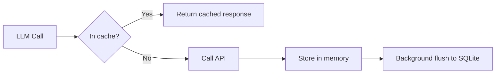

# Response Caching

AgentOpt caches LLM responses at the HTTP level to avoid redundant API calls during model selection.

## How It Works



| Property | Detail |
|:---------|:-------|
| **Cache key** | SHA-256 of the request path and body (model + messages + params), excluding `stream` |
| **In-memory** | Thread-safe dict — always active when caching is on |
| **On disk** | Optional SQLite database (`cache.db`), flushed every 10 seconds by a background thread |

Cached responses retain their original token usage and latency measurement.
Selection results use these to estimate deployment cost and latency, while
`selection_cost` excludes cache hits because they incur no new provider charge.

## Why It Matters

During model selection, many LLM calls are identical:

!!! example "Shared model calls"
    If two configurations produce the same planner request, the second can reuse the first response once it is cached. Matching depends on the request path and body, including the model, messages, and parameters. Concurrent cache misses can still make separate provider calls.

!!! example "Re-running a benchmark"
    A new run can reuse matching requests from an earlier run, including when only the scoring function changes. New requests or changed prompts can incur charges; scoring and selection still take time.

!!! info "Stopping and restarting"
    A user stop ends the selection run after the currently scheduled work completes. AgentOpt does not save or resume a selection checkpoint. Create a new selector to run again, using the same cache directory to reuse saved responses. Cache entries already flushed to disk survive process restarts; an abrupt exit can lose more recent entries.

## Choosing a Cache Directory

In local mode, `LLMTracker()` enables caching in `.agentopt_cache` by default.
Set `cache_dir` to use a benchmark-specific directory:

```python
from agentopt.proxy import LLMTracker

tracker = LLMTracker(cache_dir="./llm_cache")
selector = ModelSelector(
    ...,
    tracker=tracker,
)
results = selector.select_best()
# Cache automatically flushed to ./llm_cache/cache.db
```

On subsequent runs with the same `cache_dir`, entries are loaded from disk at
startup. Use `LLMTracker(cache_dir=None)` for memory-only caching. If
`AGENTOPT_GATEWAY_URL` selects daemon mode, cache storage is managed by the
daemon rather than these local tracker settings.

## Cache Lifecycle

| Event | What Happens |
|:------|:-------------|
| `LLMTracker(cache_dir=...)` | Creates DB if needed, loads existing entries into memory |
| LLM call (cache miss) | Response stored in memory, marked dirty |
| Background flush (every 10s) | Dirty entries written to SQLite |
| `tracker.stop()` / `select_best()` returns | Final flush to disk |
| `tracker.clear_cache()` | Clears memory and deletes all DB rows |

## Disabling Cache

```python
tracker = LLMTracker(cache=False)
```

## Inspecting the Cache

The cache is a standard SQLite database:

=== "Count entries"

    ```bash
    sqlite3 ./llm_cache/cache.db "SELECT COUNT(*) FROM cache"
    ```

=== "Inspect stored latency"

    ```bash
    sqlite3 ./llm_cache/cache.db "SELECT key, json_extract(data_json, '$.latency_seconds') FROM cache LIMIT 10"
    ```

=== "Database size"

    ```bash
    ls -lh ./llm_cache/cache.db
    ```
