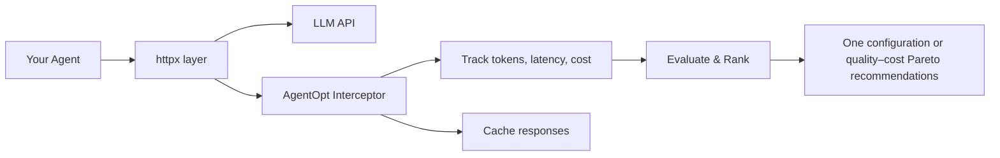

---
hide:
  - navigation
  - toc
  - footer
---

<section class="ao-hero" markdown>
<canvas id="ao-hero-canvas"></canvas>

<div class="ao-hero-inner" markdown>

<p class="ao-eyebrow">
<span class="ao-eyebrow-rule"></span>
Client-side agent optimization
<span class="ao-eyebrow-rule"></span>
</p>

# Choosing the right model for your agents can save <span class="ao-accent">100x money and time</span>

<p class="ao-sub">
AgentOpt evaluates model combinations across your full agent pipeline, measures quality, cost, and latency, and recommends a configuration or a quality–cost Pareto recommendation set.
</p>

<div class="ao-ctas" markdown>

[Get started](getting-started/quickstart.md){ .md-button .md-button--primary }
[:fontawesome-brands-github: View on GitHub](https://github.com/AgentOptimizer/agentopt){ .md-button }

</div>

</div>

<div class="ao-stats">
<div class="ao-stat">
<div class="ao-stat-num"><span class="ao-accent">Exponential</span></div>
<div class="ao-stat-label">combo space</div>
</div>
<div class="ao-stat">
<div class="ao-stat-num">Smart search</div>
<div class="ao-stat-label">on best model combination</div>
</div>
<div class="ao-stat">
<div class="ao-stat-num">0</div>
<div class="ao-stat-label">code changes</div>
</div>
<div class="ao-stat">
<div class="ao-stat-num">any</div>
<div class="ao-stat-label">agent framework</div>
</div>
</div>

</section>

---

## The Problem

Your agent has multiple steps — planning, reasoning, tool use, synthesis. Each step could use a different model. With 10 candidate models for each of 3 steps, that's **1,000 combinations**. Testing them manually is impractical. Picking blindly leaves performance (and money) on the table.

## The Solution

Give AgentOpt your agent and a small evaluation dataset (~200 examples). Gittins selection searches the model combination space and returns one recommended configuration by default. Set `objective_mode="multi"` for **quality–cost Pareto recommendations**, then choose a configuration that meets your deployment preferences.

The two-role example below uses 10 candidates per role, giving 100 configurations. Supply `planner_candidates` and `solver_candidates` as lists of model IDs accepted by your agent. The [Quick Start](getting-started/quickstart.md) shows how to define `MyAgent`, `dataset`, and `eval_fn`.

```python
from agentopt import ModelSelector

selector = ModelSelector(
    agent=MyAgent,
    models={
        "planner": planner_candidates,
        "solver": solver_candidates,
    },
    eval_fn=eval_fn,
    dataset=dataset,
)

results = selector.select_best(parallel=True)
results.print_summary()
```

This example uses the default single-objective mode. In multi mode, `results.get_recommendations()` exposes the quality–cost Pareto recommendation set, and `results.choose(...)` selects a configuration using your deployment preferences. Quality is the task score returned by `eval_fn`, such as F1 or accuracy. [Learn more about multi-objective recommendations](api/selectors.md#multi-objective-search-and-recommendations).

### Measured results: single and multi objective

Our HotpotQA benchmark evaluates 10 models per role: **100 planner–solver configurations on 200 examples each**. Quality is mean token F1; deployment cost is the mean API cost per workflow, calculated from recorded token usage.

=== "Single objective"

    With quality as the single objective, this is the highest-scoring configuration in the full benchmark:

    | Planner | Solver | Quality (token F1) | Deployment cost / workflow |
    |:---|:---|---:|---:|
    | Qwen3 32B | DeepSeek R1 | 74.66% | $0.004038 |

=== "Multi objective"

    With quality and cost as separate objectives, these three configurations are among the alternatives on the full benchmark's empirical Pareto frontier:

    | Planner | Solver | Quality (token F1) | Deployment cost / workflow |
    |:---|:---|---:|---:|
    | Ministral 3 8B | gpt-oss-20b | 68.99% | $0.000441 |
    | Qwen3 Next 80B A3B | gpt-oss-120b | 71.83% | $0.000639 |
    | Qwen3 32B | DeepSeek R1 | 74.66% | $0.004038 |

These are full-benchmark measurements, not the output of the example search above. Sources: [quality matrix](https://github.com/AgentOptimizer/agentopt-research/blob/2480b0827d5ee32025694c094c5fc1dc88107a84/data/hotpotqa/accuracy_matrix.csv), [cost matrix](https://github.com/AgentOptimizer/agentopt-research/blob/2480b0827d5ee32025694c094c5fc1dc88107a84/data/hotpotqa/cost_matrix_usd.csv), and [evaluation metadata](https://github.com/AgentOptimizer/agentopt-research/blob/2480b0827d5ee32025694c094c5fc1dc88107a84/data/hotpotqa/metadata.json).

---

## Why AgentOpt

<div class="grid cards" markdown>

-   :material-code-not-equal-variant:{ .lg .middle } **Non-Intrusive**

    ---

    Define your agent as a class. No framework adapters, no SDK wrappers, no code changes to your agent internals.

-   :material-puzzle-outline:{ .lg .middle } **Framework-Agnostic**

    ---

    Works with OpenAI, LangChain, LangGraph, CrewAI, LlamaIndex, AG2 — any framework that calls LLMs over HTTP.

-   :material-chart-scatter-plot:{ .lg .middle } **Smart Search**

    ---

    Gittins selection by default, with random, UCB, and Bayesian baselines. Allocate an evaluation budget across model configurations and questions.

-   :material-radar:{ .lg .middle } **Automatic Tracking**

    ---

    Transparently intercepts all LLM calls to measure tokens, latency, and cost. No manual instrumentation needed.

-   :material-cached:{ .lg .middle } **Response Caching**

    ---

    Identical LLM calls are cached in-memory and on disk (SQLite). Re-running experiments is instant and free.

-   :material-speedometer:{ .lg .middle } **Parallel Evaluation**

    ---

    Evaluate model combinations concurrently with configurable concurrency limits. Get results faster.

</div>

---

## How It Works



AgentOpt patches `httpx` at the transport level — the same HTTP library used by every major LLM SDK. Your agent code stays untouched. AgentOpt silently records every LLM call, caches responses, and aggregates metrics per model combination.

[:octicons-arrow-right-24: Learn more about the architecture](concepts/how-it-works.md)

---

## Selection Algorithms

| Method | Objective | Strategy |
|:---|:---|:---|
| **Auto / Gittins** | Single or multi | Cost-aware allocation with posterior recommendations |
| **Random** | Single | Random configuration order |
| **UCB** | Single | Configuration mean plus an exploration bonus |
| **Bayesian** | Single | Gaussian-process surrogate with expected improvement |
| **Random configurations** | Multi | Complete configurations in random order |
| **Random questions** | Multi | Shared random question order across all configurations |

[:octicons-arrow-right-24: Compare algorithms in detail](concepts/algorithms.md)

---

## Get Started

<div class="grid cards" markdown>

-   :material-download:{ .lg .middle } **Install**

    ---

    ```bash
    pip install agentopt-py
    ```

    [:octicons-arrow-right-24: Installation guide](getting-started/installation.md)

-   :material-rocket-launch:{ .lg .middle } **Quick Start**

    ---

    Build and optimize your first agent in 5 minutes.

    [:octicons-arrow-right-24: Quick start tutorial](getting-started/quickstart.md)

-   :material-book-open-variant:{ .lg .middle } **Examples**

    ---

    Framework-specific examples for OpenAI, LangChain, CrewAI, and LlamaIndex.

    [:octicons-arrow-right-24: Browse examples](examples/openai.md)

-   :material-api:{ .lg .middle } **API Reference**

    ---

    Full reference for selectors, results, and the tracker.

    [:octicons-arrow-right-24: API docs](api/selectors.md)

</div>
