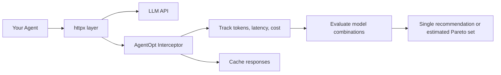

---
hide:
  - navigation
  - toc
  - footer
---

<section class="ao-hero" markdown>
<canvas id="ao-hero-canvas"></canvas>

<div class="ao-hero-inner" markdown>

<p class="ao-eyebrow">
<span class="ao-eyebrow-rule"></span>
Client-side agent optimization
<span class="ao-eyebrow-rule"></span>
</p>

# Find the right models for your agents. <span class="ao-accent">Choose your quality–cost trade-off.</span>

<p class="ao-sub">
AgentOpt evaluates model combinations across your full agent pipeline, measures accuracy, cost, and latency, and recommends a configuration or a set of accuracy–cost tradeoffs.
</p>

<div class="ao-ctas" markdown>

[Get started](getting-started/quickstart.md){ .md-button .md-button--primary }
[Watch the demo](demo.md){ .md-button }
[:fontawesome-brands-github: View on GitHub](https://github.com/AgentOptimizer/agentopt){ .md-button }

</div>

</div>

<div class="ao-stats">
<div class="ao-stat">
<div class="ao-stat-num"><span class="ao-accent">Exponential</span></div>
<div class="ao-stat-label">combo space</div>
</div>
<div class="ao-stat">
<div class="ao-stat-num">Smart search</div>
<div class="ao-stat-label">across model combinations</div>
</div>
<div class="ao-stat">
<div class="ao-stat-num">0</div>
<div class="ao-stat-label">code changes</div>
</div>
<div class="ao-stat">
<div class="ao-stat-num">any</div>
<div class="ao-stat-label">agent framework</div>
</div>
</div>

</section>

---

## The Problem

Your agent has multiple steps — planning, reasoning, tool use, synthesis. Each step could use a different model. With 5 candidate models across 3 steps, that's **125 combinations**. Testing them manually is impractical. Picking blindly leaves performance (and money) on the table.

## The Solution

Give AgentOpt your workflow, evaluation inputs, reference answers, and a scoring function. It searches combinations of models assigned to each workflow role. The default single-objective mode recommends one configuration. Multi-objective mode uses CC-Gittins to return an estimated quality–cost Pareto set, so you can choose a configuration that fits your deployment budget.

The example below uses multi-objective mode. Define `MyAgent`, `dataset`, and `eval_fn` as shown in the [Quick Start](getting-started/quickstart.md).

```python
from agentopt import ModelSelector

selector = ModelSelector(
    agent=MyAgent,
    models={
        "planner": ["gpt-4o", "gpt-4o-mini", "gpt-4.1-nano"],
        "solver":  ["gpt-4o", "gpt-4o-mini", "gpt-4.1-nano"],
    },
    eval_fn=eval_fn,
    dataset=dataset,
    objective_mode="multi",
)

results = selector.select_best(parallel=True)
recommendations = results.get_recommendations()

# Example deployment budget: $0.50 per 1,000 queries.
# The API accepts USD per query, so convert the display unit.
chosen = results.choose(max_cost_usd=0.50 / 1000)
if chosen is not None:
    print(chosen.combo)  # A model assignment for each workflow role.
```

The recommendation set contains different quality–cost trade-offs, not one universally best combination. A budget preference selects the highest conservative quality estimate among eligible recommendations; it can return `None` if none fit. Evaluation spend is the cost of searching, while deployment cost is the estimated cost of running a chosen workflow per query.


---

## Why AgentOpt

<div class="grid cards" markdown>

-   :material-code-not-equal-variant:{ .lg .middle } **Non-Intrusive**

    ---

    Define your agent as a class. No framework adapters, no SDK wrappers, no code changes to your agent internals.

-   :material-puzzle-outline:{ .lg .middle } **Framework-Agnostic**

    ---

    Works with OpenAI, LangChain, LangGraph, CrewAI, LlamaIndex, AG2 — any framework that calls LLMs over HTTP.

-   :material-chart-scatter-plot:{ .lg .middle } **Smart Search**

    ---

    Gittins search by default, with CC-Gittins for multi-objective quality–cost recommendations. Allocate evaluation effort across model combinations and questions. Random, UCB, and Bayesian alternatives are also available.

-   :material-radar:{ .lg .middle } **Automatic Tracking**

    ---

    Transparently intercepts all LLM calls to measure tokens, latency, and cost. No manual instrumentation needed.

-   :material-cached:{ .lg .middle } **Response Caching**

    ---

    Matching LLM responses can be reused from memory or disk (SQLite), avoiding repeated provider calls. New requests can still incur charges, and scoring and search still take time.

-   :material-speedometer:{ .lg .middle } **Parallel Evaluation**

    ---

    Evaluate model combinations concurrently with configurable concurrency limits. Get results faster.

</div>

---

## How It Works



AgentOpt patches `httpx` at the transport level — the same HTTP library used by every major LLM SDK. Your agent code stays untouched. AgentOpt silently records every LLM call, caches responses, and aggregates metrics per model combination.

[:octicons-arrow-right-24: Learn more about the architecture](concepts/how-it-works.md)

---

## Selection Algorithms

| Method | Objective | Strategy |
|:---|:---|:---|
| **Auto / Gittins** | Single or multi | Cost-aware allocation with posterior recommendations |
| **Random** | Single | Random configuration order |
| **UCB** | Single | Configuration mean plus an exploration bonus |
| **Bayesian** | Single | Gaussian-process surrogate with expected improvement |
| **Random configurations** | Multi | Complete configurations in random order |
| **Random questions** | Multi | Shared random question order across all configurations |

[:octicons-arrow-right-24: Compare algorithms in detail](concepts/algorithms.md)

---

## Get Started

<div class="grid cards" markdown>

-   :material-download:{ .lg .middle } **Install**

    ---

    ```bash
    pip install agentopt-py
    ```

    [:octicons-arrow-right-24: Installation guide](getting-started/installation.md)

-   :material-rocket-launch:{ .lg .middle } **Quick Start**

    ---

    Build and optimize your first agent in 5 minutes.

    [:octicons-arrow-right-24: Quick start tutorial](getting-started/quickstart.md)

-   :material-book-open-variant:{ .lg .middle } **Examples**

    ---

    Framework-specific examples for OpenAI, LangChain, CrewAI, and LlamaIndex.

    [:octicons-arrow-right-24: Browse examples](examples/openai.md)

-   :material-api:{ .lg .middle } **API Reference**

    ---

    Full reference for selectors, results, and the tracker.

    [:octicons-arrow-right-24: API docs](api/selectors.md)

</div>
